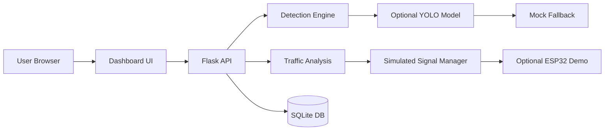
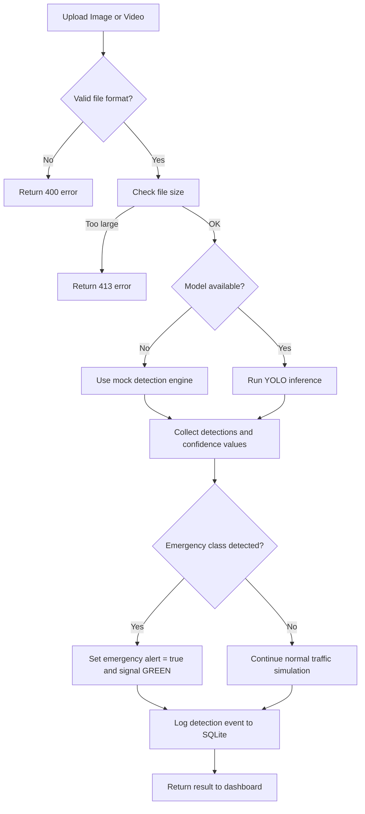
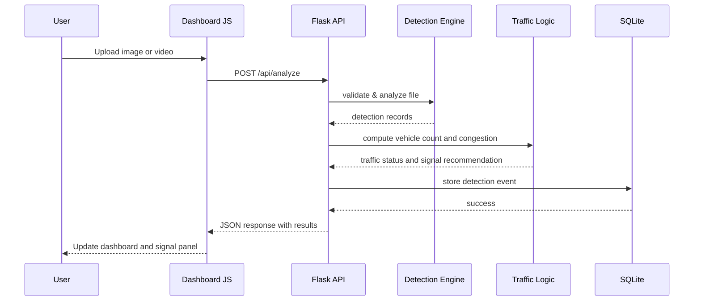
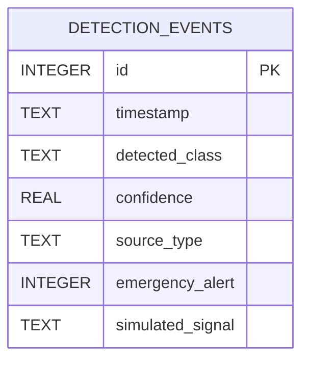

# Technical Design Document

## 1. System Overview

AELMS is a college-level prototype built to process traffic video or image input, detect emergency vehicles, estimate traffic congestion, and simulate an emergency corridor using a web dashboard and REST API. The prototype is designed to run on a normal Windows PC and is intentionally built to degrade gracefully in mock mode when model weights are unavailable.

The solution separates concerns between:

- the Flask backend
- the AI detection layer
- the traffic analysis and emergency logic
- the SQLite database layer
- the HTML/CSS/JavaScript dashboard
- optional hardware integration examples

This project is a demo prototype and does not claim to control live public roads or traffic lights without proper hardware validation and regulatory approval.

## 2. Functional Requirements

### Detection
- Accept image or video files uploaded from a browser.
- Detect common vehicle classes using a mock mode or optional YOLO model.
- Flag emergency classes such as ambulance and fire engine when supported.
- Display confidence scores and bounding boxes in outputs.
- Gracefully handle missing model files and unsupported formats.

### Traffic Analysis
- Count detected vehicles and assess congestion using simple thresholds.
- Determine whether congestion is low, moderate, or heavy.
- Show prototype estimates clearly, not official measurements.

### Emergency Corridor Simulation
- Trigger a simulated signal change when emergency vehicle detection occurs.
- Support manual override and reset operations.
- Label the system clearly as a simulation.

### Dashboard
- Display project overview, upload controls, status widgets, and event history.
- Present a responsive dark UI suitable for a smart-city demo.

### Data Logging
- Store recent events in SQLite with timestamp, class, confidence, alert state, and signal state.

### Optional IoT
- Provide documentation and an optional ESP32 sketch that can receive simulated traffic-light commands on a local test interface only.

## 3. Non-Functional Requirements

- Python 3.11+ compatibility
- No GPU requirement for the prototype
- Mock mode must work without internet access or model downloads
- Upload limits to prevent oversized files
- Safe temporary file handling and secure naming
- Clear user-friendly error messages
- Simple local deployment for academic use

## 4. System Architecture

The architecture uses a thin client-server model. The browser submits image or video files to the Flask backend, which performs detection, updates traffic metrics, logs events, and serves the dashboard.

### Components
- Frontend dashboard: HTML, CSS, JavaScript
- Backend API: Flask routes and validation layer
- Detection engine: mock detection or optional YOLO integration
- Traffic logic: congestion thresholds and emergency handling
- Database: SQLite event persistence
- Hardware extension: optional ESP32 example docs and sketch

## 5. AI Detection Workflow

1. User uploads an image or video.
2. The backend validates the format and file size.
3. The detection engine checks whether a YOLO model is available.
4. If the model is missing, the system falls back to deterministic mock results.
5. The backend evaluates whether emergency classes were detected.
6. Traffic state is updated and an emergency message is prepared.
7. The event is logged to SQLite.
8. Results are returned to the dashboard.

## 6. Backend/Frontend Interaction

The frontend uses fetch calls to the Flask API. Results are rendered without reloading the page. The dashboard updates counts, signal state, and recent events after upload or signal simulation.

## 7. Database Design

The SQLite table `detection_events` stores:

- id: integer primary key
- timestamp: ISO-8601 UTC timestamp
- detected_class: text class label
- confidence: real confidence value
- source_type: upload or webcam
- emergency_alert: boolean flag
- simulated_signal: RED / YELLOW / GREEN

## 8. API Design

- `GET /api/health` returns app status and runtime mode
- `GET /api/events` returns recent detection events
- `POST /api/analyze` submits an uploaded file for inspection
- `GET /api/traffic/status` returns traffic counts and signal state
- `POST /api/traffic/simulate` changes the simulated signal state
- `POST /api/reset` resets the demo and clears event history

## 9. Error Handling

- Unsupported file types are rejected with a 400 response.
- Oversized uploads are rejected with a 413 response.
- Missing model files are handled by the mock fallback path.
- Invalid manual signal requests are rejected with a clear message.
- Internal exceptions are not exposed to the client in production-ready mode.

## 10. Security Considerations

- File uploads are validated by file extension and size.
- File names are sanitized before saving.
- Configuration values remain in environment variables and `.env.example`.
- Sensitive keys and local settings are not checked into source control.

## 11. Performance Considerations

- The prototype uses lightweight mock detection for reproducibility.
- Model execution is isolated behind the detection engine interface for easier extension.
- SQLite keeps event storage simple and portable for local demonstrations.

## 12. Hardware Integration Architecture

The software architecture supports an optional local hardware extension via a separate ESP32 example. That example uses a local test fixture instead of production infrastructure, and all hardware actions are clearly labeled as simulation-only.

## 13. Limitations and Future Improvements

- This is a prototype only, not a real traffic system.
- The AI layer is demonstration-grade and not a certified road-safety model.
- Actual signal control requires hardware validation, permissions, and a controlled test environment.
- Future enhancements could include live camera streams, more robust object detection, analytics dashboards, and production deployment architecture.

## 14. Architectural Diagrams

